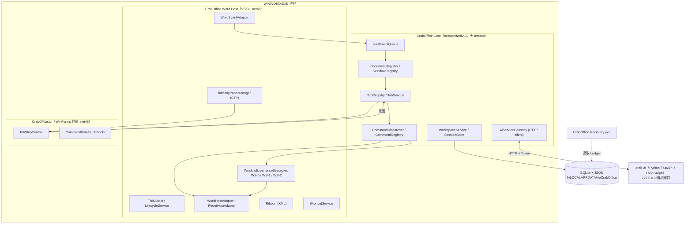
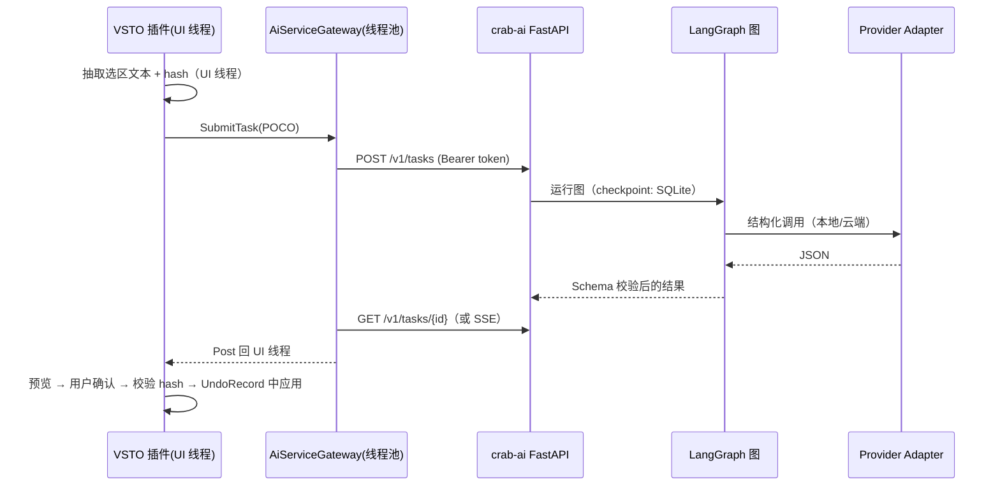

# 03 · 技术架构与接口规范

> 版本 v0.1 · 2026-11-05 · 状态：设计稿（接口为建议签名，PoC 后可调整）

## 1. 架构目标与约束

1. **宿主隔离**：Office COM 只出现在宿主适配层（`*.Host` 项目），Core 层不引用任何 Interop 程序集，可在无 Office 环境下单元测试。
2. **单一副作用入口**：所有改变 Word 状态的动作经 `ICommandDispatcher`。
3. **线程纪律**：Office OM 只在 Word 主 STA 线程访问；Core 状态只在 UI 线程变更；后台线程只做 IO/计算。
4. **可恢复**：任何改变窗口状态的模块实现 `IRestorable`，可逆。
5. **AI 解耦**：AI 服务是可选外部进程，不在标签/窗口链路上。
6. **宿主可扩展**：Word 与 PowerPoint 通过 `IOfficeHostAdapter` 抽象共享 Core。

## 2. 候选架构对比

### 架构 A：进程内分层单体（推荐）
VSTO 加载项（进程内）包含 Host + Core + UI；AI 为独立本地 Python 服务；Recovery 为独立小程序。

### 架构 B：瘦宿主 + 进程外常驻服务
VSTO 只做事件转发与命令执行；状态、工作区、跨进程聚合、AI 编排在独立 .NET 8 常驻进程（命名管道通信）。

### 架构 C：非托管 C++ COM 加载项 + .NET Core
C++ 实现 `IDTExtensibility2`、`ICustomTaskPaneConsumer`、`IRibbonExtensibility`，UI/逻辑另行承载。

| 维度 | A 进程内分层 | B 瘦宿主+常驻服务 | C C++ COM |
|---|---|---|---|
| 实现复杂度 | 低-中 | 高（IPC、生命周期、两个进程状态一致性） | 高 |
| 标签切换延迟 | 最低（同线程调用） | +IPC 往返（~1ms 级，但需处理顺序/重入） | 最低 |
| 跨 Word 进程聚合标签 | 不支持（可后期加） | 支持 | 不支持 |
| 崩溃隔离 | 插件异常影响 Word 进程（需严格 try/catch） | 服务崩溃不影响 Word | 同 A，且原生崩溃更致命 |
| 加载速度 | 受 VSTO/CLR 启动影响 | 同 A | 最快 |
| 可测试性 | Core 可单测 | 高 | 低 |
| 适合阶段 | M0–M4 | 若需要跨进程工作区时演进 | 仅作加载性能后备 |

**建议**：采用架构 A，但 Core 接口按“可序列化命令/事件”设计（`CommandRequest`、`DomainEvent` 均为可 JSON 序列化的 POCO），未来可无痛演进到架构 B。

## 3. 模块与解决方案结构



| 项目 | 目标框架 | 说明 |
|---|---|---|
| `CrabOffice.Core` | netstandard2.0 | 领域模型、Registry、TabService、CommandDispatcher、Workspace、AI 网关契约。可被 net48 与 net8 测试项目引用 |
| `CrabOffice.Storage` | netstandard2.0 | SQLite（`Microsoft.Data.Sqlite` 或 `System.Data.SQLite`，需验证 VSTO 中原生 DLL 加载路径）、JSON 迁移 |
| `CrabOffice.UI` | net48 WinForms | 自绘标签控件、面板、命令面板 |
| `CrabOffice.Word.Host` | net48 VSTO | Word 宿主适配 |
| `CrabOffice.PowerPoint.Host` | net48 VSTO | E 组 |
| `CrabOffice.Recovery` | net48 或 net8 | 外部恢复工具 |
| `CrabOffice.Core.Tests` | net8.0 + net48 | xUnit，模拟宿主 |
| `crab-ai/` | Python 3.11+ | FastAPI + LangGraph + Provider Adapter |

### 3.3 UI 技术选择
- **首选 WinForms 自绘**（`UserControl` + `OnPaint` + 双缓冲）：CTP 原生承载 WinForms；DPI 计算可控；无 ElementHost 互操作开销。
- WPF（`ElementHost`）作为 PoC-1 对照：动画与样式更方便，但混合 DPI、焦点、键盘消息路由风险更高。
- AI 面板（D 组）：WebView2 嵌入 CTP（`Microsoft.Web.WebView2.WinForms`），需注意用户数据目录必须指定到 `%LOCALAPPDATA%\CrabOffice\WebView2`（宿主进程 WINWORD.EXE 所在目录不可写）。
- 图标：FontAwesome（Free，SIL OFL/CC BY 4.0 许可）字体内嵌为私有字体（`PrivateFontCollection`），按 DPI 绘制。

## 4. 领域模型（C#）

```csharp
// 标识：会话内有效，不得作为跨会话主键
public readonly record struct DocumentId(Guid Value);
public readonly record struct WindowId(Guid Value);
public readonly record struct TabId(Guid Value);

public enum HostKind { Word, PowerPoint }
public enum WindowKind { Normal, ProtectedView }
public enum SavedState { Saved, Dirty, Unknown }
public enum HiddenBy { None, CrabOffice, CrabOfficeBatch, External }

public sealed record DocumentRecord(
    DocumentId Id, HostKind Host,
    string DisplayName,              // Document.Name
    string? FullName,                // 未保存为 null
    string? CanonicalPath,           // 规范化路径/URL，跨会话文件身份
    bool IsUntitled, bool IsReadOnly, bool IsTemplate,
    SavedState Saved, bool? AutoSaveOn,
    DateTime FirstSeenUtc, DateTime? ClosingCandidateSinceUtc);

public sealed record WindowRecord(
    WindowId Id, DocumentId DocumentId, WindowKind Kind,
    long Hwnd,                       // 仅窗口存活期有效
    int WordProcessId, int WindowNumber, string Caption,
    bool IsActive, bool IsVisible, HiddenBy HiddenBy,
    DateTime LastActivatedUtc);      // MRU

public sealed record TabRecord(
    TabId Id, WindowId WindowId, int Order, bool IsPinned,
    string? GroupId, string DisplayLabel, string? DisambiguationSuffix);

public sealed record RegistrySnapshot(
    long Version, IReadOnlyList<DocumentRecord> Documents,
    IReadOnlyList<WindowRecord> Windows, IReadOnlyList<TabRecord> Tabs,
    WindowId? ActiveWindowId);

// 持久化模型（跨会话）
public sealed record Workspace(
    Guid WorkspaceId, string Name, int SchemaVersion,
    IReadOnlyList<WorkspaceItem> Items, string? ActiveCanonicalPath,
    DateTime CreatedAtUtc, DateTime UpdatedAtUtc);
public sealed record WorkspaceItem(string CanonicalPath, int Order, bool IsPinned, string? GroupId);

public sealed record CommandRequest(
    string CommandId, IReadOnlyList<TabId> TargetTabIds,
    IReadOnlyDictionary<string, object?> Options, Guid CorrelationId,
    CommandSource Source);           // Ui | Shortcut | Palette | Ai | Workspace
```

**身份规则**（A13）：`DocumentId ≠ WindowId ≠ TabId`；一个 Document 可有多个 Window；一个 Tab 对应一个 Window；跨会话只用 `CanonicalPath`。COM 对象引用**不进入**任何 record，单独存于宿主层 `ComReferenceTable`。

## 5. 接口规范

### 5.1 通用结果与错误
```csharp
public enum ResultStatus { Ok, Cancelled, NotFound, Busy, Rejected, Failed }
public sealed record OpResult(ResultStatus Status, string? ErrorCode = null, string? Message = null, Exception? Exception = null);
public sealed record OpResult<T>(ResultStatus Status, T? Value, string? ErrorCode = null, string? Message = null);
```
错误码约定：`HOST.OBJECT_GONE`（COM 对象已删除）、`HOST.MODAL_ACTIVE`、`HOST.USER_CANCELLED`、`HOST.COM_ERROR`、`CMD.NOT_ALLOWED`、`CMD.INVALID_ARGS`、`STRATEGY.ENTER_FAILED`、`AI.UNAVAILABLE`、`AI.SCHEMA_INVALID`。

### 5.2 宿主适配层
```csharp
/// 线程：所有方法必须在宿主 UI(STA) 线程调用，否则抛 InvalidOperationException。
/// 生命周期：与 ThisAddIn 同生命周期；Quit 后所有方法返回 Rejected。
public interface IOfficeHostAdapter
{
    HostKind Host { get; }
    HostSnapshot EnumerateDocumentsAndWindows();                 // 对账真相源
    OpResult ActivateWindow(WindowId id);
    OpResult<WindowId?> OpenDocument(OpenRequest request);      // 结果仍以事件/对账为准
    OpResult<WindowId?> NewDocument(NewDocumentRequest request);
    OpResult CloseTarget(WindowId id, CloseOptions options);    // 用户取消 => Cancelled
    OpResult SaveTarget(WindowId id, SaveOptions options);
    OpResult SetWindowVisible(WindowId id, bool visible);       // WS-1 使用
    OpResult<WindowPlacementInfo> GetPlacement(WindowId id);
    OpResult ApplyPlacement(WindowId id, WindowPlacementInfo placement);
    bool IsModalActive();                                       // 模态对话框检测
}
public interface IWordHostAdapter : IOfficeHostAdapter { /* Word 特有：ProtectedView、UndoRecord 等 */ }
public interface IPresentationHostAdapter : IOfficeHostAdapter { /* 放映状态等 */ }

public sealed record HostSnapshot(IReadOnlyList<HostDocumentInfo> Documents, IReadOnlyList<HostWindowInfo> Windows, long? ActiveHwnd);
public sealed record HostWindowInfo(long Hwnd, int DocumentKey, WindowKind Kind, int WindowNumber, string Caption, bool Visible);
public sealed record WindowPlacementInfo(string MonitorDevice, int ShowCmd, Rect NormalRectPx, uint Dpi);
```

### 5.3 事件接入与 Registry
```csharp
public interface IHostEventSink { void Enqueue(HostEvent e); }      // 任意 COM 事件处理器调用；只入队
public sealed record HostEvent(long Seq, HostEventKind Kind, long? Hwnd, DateTime ReceivedAtUtc, object? RuntimeToken);

public interface IDocumentRegistry
{
    RegistrySnapshot GetSnapshot();                               // 不可变快照，线程安全读取
    void ApplyHostEvent(HostEvent e);                             // UI 线程
    ReconcileReport Reconcile(HostSnapshot truth, ReconcileTrigger trigger); // UI 线程
    WindowId? TryResolveByHwnd(long hwnd);
    event EventHandler<RegistryChangedEventArgs> RegistryChanged;  // 在 UI 线程引发，携带 diff
}
```

### 5.4 标签服务
```csharp
public interface ITabService
{
    IReadOnlyList<TabRecord> GetTabs();
    OpResult ActivateTab(TabId id, CommandSource source);
    OpResult MoveTab(TabId id, int newIndex);
    OpResult PinTab(TabId id, bool pinned);
    Task<BatchCommandResult> CloseTabs(CloseRequest request);     // 逐项遵守 Word 保存流程；await 期间在 UI 线程继续
    IReadOnlyList<TabSearchHit> SearchTabs(string query);
    event EventHandler<TabsChangedEventArgs> TabsChanged;         // UI 线程
}
```

### 5.5 窗口体验策略（A04 核心）
```csharp
public interface IWindowExperienceStrategy : IRestorable
{
    string StrategyId { get; }                                    // "WS-0" | "WS-1" | "WS-2"
    OpResult Enter(WindowId? primary);                            // 失败须自动回滚为 Native
    OpResult SwitchTo(WindowId target, Guid correlationId);
    void OnWindowAppeared(WindowId id);
    void OnWindowRemoved(WindowId id);
    void OnWindowActivatedExternally(WindowId id);                // 如 Ctrl+F6 激活隐藏窗口
    OpResult Exit();
}
public interface IRestorable { OpResult RestoreNativeState(RestoreReason reason); } // 必须幂等，可在异常处理器中调用
public enum RestoreReason { UserExit, Shutdown, Disable, UnhandledException, Watchdog, Recovery }
```

### 5.6 命令
```csharp
public interface ICommand
{
    string CommandId { get; }                 // 如 "tab.close", "doc.saveAll", "export.pdf"
    CommandDescriptor Descriptor { get; }
    CanExecuteResult CanExecute(CommandContext ctx);
    Task<OpResult> ExecuteAsync(CommandContext ctx, CancellationToken ct);
}
public interface ICommandDispatcher
{
    CanExecuteResult CanExecute(CommandRequest request);
    Task<CommandResult> Execute(CommandRequest request, CancellationToken ct = default); // 串行执行队列，防重入
    CommandResult? GetResult(Guid correlationId);
}
```
规则：Dispatcher 维护单一串行队列（同一时刻一个修改型命令）；`Source == Ai` 的请求必须命中 `AiCommandWhitelist` 并通过 JSON Schema 参数校验。

### 5.7 工作区/会话
```csharp
public interface IWorkspaceService
{
    Task<OpResult<Guid>> SaveWorkspace(string name, WorkspaceSaveOptions options);
    Task<WorkspaceLoadReport> LoadWorkspace(Guid workspaceId, WorkspaceLoadMode mode, IProgress<WorkspaceLoadProgress>? progress, CancellationToken ct);
    Task<IReadOnlyList<WorkspaceSummary>> ListWorkspaces();
    Task<IReadOnlyList<RecentClosedEntry>> ListRecentClosed(int limit = 20);
    Task<OpResult> AddToWorkspace(Guid workspaceId, IReadOnlyList<TabId> tabs);
}
```

### 5.8 AI 网关
```csharp
public interface IAiServiceGateway
{
    Task<OpResult<AiTaskHandle>> SubmitTask(AiTaskRequest request, CancellationToken ct);
    Task<OpResult<AiTaskStatus>> GetTask(string taskId, CancellationToken ct);
    Task<OpResult> CancelTask(string taskId);
    Task<AiHealth> CheckHealth();
}
```
线程：网络 IO 在线程池；回调通过 `SynchronizationContext.Post` 回到 UI；**AI 网关从不直接接触 COM**，需要文档文本时由 UI 线程先抽取为 POCO。

### 5.9 领域事件（Core 内发布，UI 线程）
| 事件 | 负载 | 订阅者 |
|---|---|---|
| `DocumentAppeared` | DocumentId, WindowId | TabService, Session |
| `DocumentClosed`（对账确认） | DocumentId, CanonicalPath?, wasPinned, order | B01, Session |
| `WindowActivated` | WindowId, source | TabStrip, Strategy |
| `SavedStateChanged` | DocumentId, SavedState | TabStrip, B04 |
| `DocumentRenamed` | DocumentId, oldPath, newPath | Tabs, Workspace |
| `StrategyModeChanged` | mode, strategyId | UI |
| `SafeModeEntered` | reason | 全部 |

## 6. 线程与事件安全规范

1. `ThisAddIn_Startup` 捕获 `WindowsFormsSynchronizationContext` 作为 `UiContext`；提供 `UiContext.Post/Send` 与 `UiThreadGuard.Assert()`（DEBUG 下断言）。
2. COM 事件处理器模板：
```csharp
private void OnWindowActivate(Word.Document doc, Word.Window wn)
{
    try { _sink.Enqueue(HostEvent.WindowActivated(SafeHwnd(wn), wn)); }
    catch (Exception ex) { _log.Error(ex, "WindowActivate handler"); } // 绝不抛回 Word
}
```
3. 事件处理在 `Post` 后执行，避免在 Word 回调栈中做重入式 OM 调用（如在 DocumentOpen 中立即 Activate 其他窗口）。
4. `ComReferenceTable`：`Dictionary<WindowId, Word.Window>`，仅 UI 线程访问；访问失败（`COMException`/`InvalidComObjectException`）→ 标记失效 + 对账。
5. 不在 `finalizer` 或后台线程释放 COM 对象；Shutdown 时清空表并 `GC.Collect(); GC.WaitForPendingFinalizers()` 一次（VSTO 常规做法）。
6. 后台定时器使用 `System.Windows.Forms.Timer`（UI 线程）进行 COM 轮询；`System.Threading.Timer` 仅用于非 COM 工作。
7. 重入：Registry 变更期间若再次收到事件 → 排队；`TabsChanged` 处理程序中禁止调用修改型命令（静态分析/约定 + DEBUG 断言）。

## 7. AI 服务架构（D 组）


- 进程管理：插件按需启动 `crab-ai`（随机端口写入 `%LOCALAPPDATA%\CrabOffice\runtime\ai.json`，含一次性 token），空闲 10 分钟退出。
- 接口：`POST /v1/tasks`、`GET /v1/tasks/{id}`、`POST /v1/tasks/{id}/cancel`、`GET /v1/health`；任务类型：`polish`、`translate`、`qa`、`review`、`terms`、`plan`、`library.*`。
- 安全：仅绑定 127.0.0.1；token 校验；请求体大小上限；日志不记录正文（可配置）；云端 Provider 需用户显式开启并显示数据外发提示。
- 输出契约：Pydantic 模型 → JSON Schema 共享给 C#（生成 DTO），双端校验。

## 8. 数据层

位置：`%LOCALAPPDATA%\CrabOffice\`
| 文件 | 内容 | 格式 |
|---|---|---|
| `settings.json` | UI/快捷键/模式设置 | JSON，`schemaVersion` |
| `crab.db` | workspaces、workspace_items、recent_closed、favorites、snippets、replace_rules、glossary | SQLite，`PRAGMA user_version` 迁移 |
| `runtime/hidden-<pid>.json` | HiddenWindowLedger | JSON，原子写（临时文件 + `File.Replace`） |
| `runtime/crash-<pid>.json` | CrashMarker | JSON |
| `logs/` | 滚动日志 | 文本，不含正文 |

SQLite 原生 DLL 在 VSTO 中的加载（x64，部署目录为 ClickOnce 缓存或 MSI 安装目录）需 PoC-0 验证；若有问题，B 组可先使用 JSON 文件。

## 9. PowerPoint 宿主适配要点

| 关注点 | Word | PowerPoint |
|---|---|---|
| 文档集合 | `Documents` | `Presentations` |
| 窗口 | `Window`（`Hwnd`、`Visible`） | `DocumentWindow`（`HWND`；`Visible` 成员【待查证，可能不存在】） |
| 关闭完成事件 | 无（需对账） | `PresentationCloseFinal` |
| 新建/打开 | `NewDocument`/`DocumentOpen` | `AfterNewPresentation`/`AfterPresentationOpen` |
| 撤销分组 | `UndoRecord` | 无等价 API |
| 特殊窗口 | 受保护视图 | 受保护视图、放映窗口、演示者视图 |

Core 中所有逻辑只依赖 `IOfficeHostAdapter`；PowerPoint 的单窗口策略需要独立实现与 PoC，不复用 WS-1 的结论。

## 10. 部署

- 开发期：VS F5（HKCU 注册）。
- 发布：MSI（WiX）按用户安装，写 `HKCU\Software\Microsoft\Office\Word\Addins\CrabOffice.Word`（`LoadBehavior=3`、`Manifest=…vsto|vstolocal`）；代码签名证书（避免信任提示）；附带 `CrabOffice.dotm`（仅当 K1 快捷键方案被采用）、Recovery 工具、可选 AI 服务包。
- 卸载：移除注册表、模板、runtime 目录；询问是否保留用户数据。
